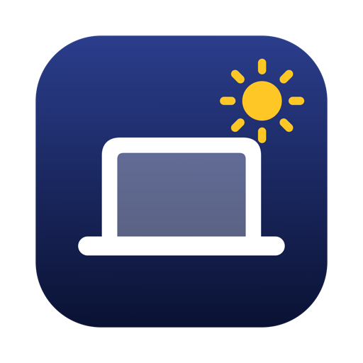

<p align="center"></p>

<h1 align="center">LidAwake</h1>

<p align="center"><b>맥북 뚜껑을 닫아도 안 꺼지게 해 주는 무료 메뉴바 앱</b><br>
Keep your MacBook running with the lid closed. One click in the menu bar.</p>

<p align="center">
<a href="https://getlidawake.vercel.app">소개 페이지</a> ·
<a href="https://github.com/jinnyjiinlee/lid-awake/releases/latest/download/LidAwake.zip">다운로드</a> ·
<a href="#english">English</a>
</p>

---

터미널에 `sudo pmset -a disablesleep 1` 을 매번 치는 대신, 메뉴바 아이콘을 눌러 켜고 끄면 돼요.

- 해 아이콘 = 켜짐 (뚜껑 닫아도 안 꺼짐)
- 달 아이콘 = 꺼짐 (평소처럼 잠자기)

## 설치

**방법 1. 한 줄 설치 (추천, 경고창 없음)**

터미널(⌘ + 스페이스 → "터미널")에 붙여넣고 엔터.

```bash
curl -fsSL https://getlidawake.vercel.app/install.sh | bash
```

**방법 2. 직접 다운로드**

1. [LidAwake.zip](https://github.com/jinnyjiinlee/lid-awake/releases/latest/download/LidAwake.zip) 받아서 더블클릭
2. `LidAwake` 를 **응용 프로그램** 폴더로 옮기기
3. 앱을 열면 "확인할 수 없음" 경고 → **완료**
4. **시스템 설정 → 개인정보 보호 및 보안** 맨 아래 **그래도 열기**

macOS 12 이상, Apple 실리콘·인텔 모두 돼요. 처음 열면 맥 비밀번호를 한 번만 넣어 두면, 다음부터는 클릭만으로 켜고 끌 수 있어요.

## 기능

| 기능 | 설명 |
|---|---|
| 계속 켜두기 | 끌 때까지 뚜껑 닫아도 안 꺼져요 |
| 시간 정해서 켜기 | 1·2·4·8시간 뒤 자동으로 꺼져요. 남은 시간이 메뉴바에 보여요 |
| 배터리 안전장치 | 충전기 없이 배터리가 20% 이하면 자동으로 꺼지고 알려 줘요 |
| 과열 안전장치 | 맥이 과열 상태가 되면 바로 꺼져요 |
| 로그인할 때 자동 실행 | macOS 13 이상 |
| 새 버전 알림 | 새 버전이 나오면 메뉴에 표시돼요 |
| 한국어 / English | 맥 언어 설정에 맞춰 바뀌어요 |

## 꼭 알아 두세요

- **가방에 넣을 땐 꺼 주세요.** 안전장치가 있어도, 닫힌 채 켜져 있으면 열이 나고 배터리가 빨리 닳아요.
- 이 설정은 재부팅해도 남아요. 그래서 메뉴바 아이콘으로 상태를 늘 보여 주고, 켜둔 채 종료하려 하면 한 번 더 물어봐요.
- 메뉴바 아이콘이 노치에 가려 안 보이면, 응용 프로그램에서 LidAwake를 다시 열면 켜기·끄기 창이 떠요.

## 지우는 방법

1. 메뉴에서 **끄기** → **비밀번호 없이 쓰기 해제** → **종료**
2. 응용 프로그램 폴더에서 `LidAwake` 를 휴지통으로

## 어떻게 동작하나요

- 켜기/끄기는 `pmset -a disablesleep 1` / `0` 을 실행해요.
- "비밀번호 없이 쓰기"는 `/etc/sudoers.d/lidawake` 파일 하나를 만들어서 **딱 이 두 명령만** 비밀번호 없이 실행되게 해요.
- 코드는 `Sources/main.swift` 한 파일이에요. 직접 빌드: `./build.sh` (Xcode 명령줄 도구 필요)

---

<a name="english"></a>
## English

LidAwake is a free menu bar app that keeps your MacBook awake with the lid closed (toggles `pmset disablesleep`).

**Install**

```bash
curl -fsSL https://getlidawake.vercel.app/install.sh | bash
```

Or [download the zip](https://github.com/jinnyjiinlee/lid-awake/releases/latest/download/LidAwake.zip), move it to Applications, and allow it in **System Settings → Privacy & Security → Open Anyway** (the app isn't signed with a paid Apple Developer ID).

**Features:** keep awake / timer (1·2·4·8h, countdown in the menu bar) / auto-off below 20% battery / auto-off when the Mac overheats / open at login / update notice / Korean & English.

**Note:** turn it off before putting your Mac in a bag. The only privileged commands are `pmset -a disablesleep 1` and `0`, allowed via `/etc/sudoers.d/lidawake`.

## License

MIT · Made by [DAYFOCUSLAB](https://www.dayfocuslab.com)
